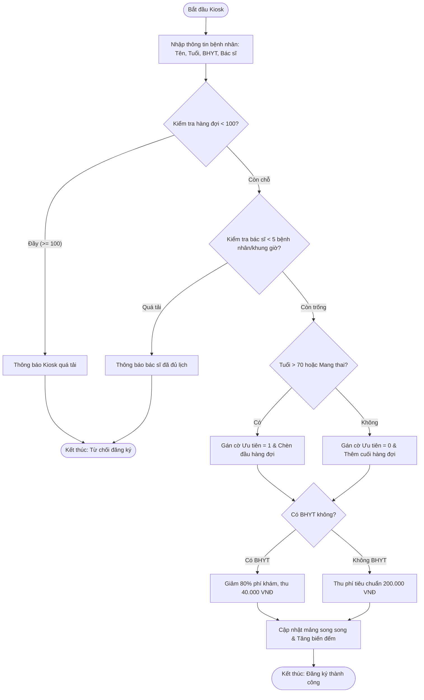

# BÁO CÁO PHÂN TÍCH KIẾN TRÚC VÀ MÃ NGUỒN MINI MODULE KIOSK ĐĂNG KÝ KHÁM BỆNH TỰ ĐỘNG MEDCARE

> 👤 **Học viên:** Hoàng Công Dũng | **Mã SV:** PTIT-HCM-009
> 🏫 **Môn học:** it102-rl-hoangcongdung

---

## 📊 Sơ đồ thiết kế hệ thống (Activity Diagram)

> 💡 *Sơ đồ dưới đây được render tự động trực tiếp trên GitHub bằng Mermaid. Bạn cũng có thể tải file **`bt4.drawio`** trong repository này để mở và chỉnh sửa trực tiếp trên [Draw.io (diagrams.net)](https://app.diagrams.net).* 

---

## 1. Thiết kế Kiến trúc Mảng Song Song (Parallel Arrays)

Để giải quyết bài toán quản lý hàng đợi tối đa 100 bệnh nhân trong môi trường C cơ bản mà không sử dụng cấu trúc phức tạp hay con trỏ động, tôi sử dụng kiến trúc mảng song song (Parallel Arrays). Các mảng được khai báo đồng bộ kích thước MAX_SIZE = 100:

- int stt_arr[MAX_SIZE]: Lưu trữ số thứ tự phát hành cho bệnh nhân.

- char name_arr[MAX_SIZE][30]: Lưu trữ họ tên bệnh nhân (chuỗi tối đa 30 ký tự, xử lý an toàn bằng fgets).

- int age_arr[MAX_SIZE]: Lưu trữ độ tuổi để phục vụ logic phân loại ưu tiên.

- int priority_arr[MAX_SIZE]: Lưu trạng thái ưu tiên ('1' nếu là diện ưu tiên như trên 70 tuổi hoặc mang thai, '0' nếu là thường).

- int bhyt_arr[MAX_SIZE]: Lưu trạng thái Bảo hiểm Y tế ('1' có BHYT, '0' không có).

- int fee_arr[MAX_SIZE]: Lưu chi phí khám sơ bộ sau khi đã áp dụng chính sách giảm giá.

- Đồng bộ hóa chỉ số (Index Synchronization): Mọi thông tin của bệnh nhân thứ i đều nằm tại vị trí i trên tất cả các mảng.
- Xử lý dồn dịch (Shifting): Khi xóa hoặc chèn ưu tiên, toàn bộ các mảng phải được dịch chuyển đồng thời để giữ vững tính toàn vẹn dữ liệu.

## 2. Giải pháp kỹ thuật cho các nghiệp vụ cốt lõi

Module được thiết kế với vòng lặp điều khiển menu liên tục, xử lý triệt để hiện tượng trôi lệnh bộ đệm bàn phím khi kết hợp scanf và fgets.

Kiểm soát tải bác sĩ: Hệ thống đếm số lượng bệnh nhân hiện tại đang đăng ký vào cùng một khung giờ/bác sĩ, nếu chạm mốc 5 sẽ từ chối nhận thêm.

Cơ chế chèn ưu tiên: Khi phát hiện bệnh nhân thuộc diện ưu tiên (>70 tuổi hoặc mang thai), thuật toán thực hiện dồn dịch mảng từ cuối lên để chèn bệnh nhân vào ngay sau nhóm ưu tiên hiện tại, đảm bảo không xếp sau bệnh nhân thường.

- Tính toán BHYT tự động: Giá gốc 200.000 VNĐ, nếu bhyt_arr bằng 1 thì chi phí được ghi nhận là 40.000 VNĐ.
- Xóa phần tử an toàn: Khi hủy lịch khám theo STT, thực hiện vòng lặp dịch chuyển các phần tử phía sau đè lên vị trí hiện tại và giảm biến đếm tổng số lượng bệnh nhân, tuyệt đối không để lại ô nhớ rác.

## 3. Bảng đặc tả quy trình nghiệp vụ trên Kiosk

Bảng mô tả chi tiết các bước xử lý của hệ thống từ khi bệnh nhân thao tác trên Kiosk đến khi hoàn tất lưu trữ:

| Bước | Tác nhân | Hành động nghiệp vụ | Kiểm tra kỹ thuật & Bẫy dữ liệu |
| --- | --- | --- | --- |
| 1 | Bệnh nhân | Nhập thông tin cá nhân trên màn hình Kiosk | Sử dụng fgets() chống tràn bộ đệm, xóa ký tự '\n' dư thừa |
| 2 | Hệ thống C | Kiểm tra giới hạn số lượng hàng đợi | Nếu tổng số bệnh nhân >= 100, từ chối tiếp nhận |
| 3 | Hệ thống C | Kiểm tra tải của bác sĩ trong khung giờ | Nếu số lượng đăng ký cho bác sĩ đã đạt 5, báo lỗi quá tải |
| 4 | Hệ thống C | Phân loại đối tượng ưu tiên | Nếu tuổi > 70 hoặc là phụ nữ mang thai -> Chèn lên đầu hàng đợi |
| 5 | Hệ thống C | Tính toán chi phí khám bệnh sơ bộ | Nếu có BHYT (bhyt = 1) tính 40k, ngược lại tính 200k |
| 6 | Hệ thống C | Cập nhật mảng song song & tăng biến đếm | Ghi nhận thành công và hiển thị STT cho bệnh nhân |

## 4. Hướng dẫn biên dịch và chạy chương trình

Mã nguồn được đặt tại thư mục clinic_appointment_module/main.c trong repository GitHub cá nhân 'it102-rl-hoangcongdung'.

Để biên dịch và chạy trên môi trường GCC (Visual Studio Code), sinh viên thực hiện các lệnh sau trên terminal:

1. Truy cập thư mục: cd clinic_appointment_module

2. Biên dịch: gcc main.c -o clinic_kiosk

3. Thực thi: ./clinic_kiosk (hoặc clinic_kiosk.exe trên Windows).

- Chương trình hoàn toàn tu chuẩn ANSI C, không sử dụng thư viện bên thứ ba.
- Đảm bảo an toàn bộ nhớ tĩnh và không gây lỗiSegmentation Fault.

---

## 📁 Danh sách tệp tin nộp bài trong Repository
- 📝 `bt4.docx`: Báo cáo tài liệu phân tích nghiệp vụ hoàn chỉnh.
- 🎨 `bt4.drawio`: File thiết kế sơ đồ chuẩn theo quy định đề bài (mở trực tiếp bằng [Draw.io](https://app.diagrams.net) hoặc Lucidchart).
- 💻 `clinic_appointment_module/main.c`: Mã nguồn chương trình.
